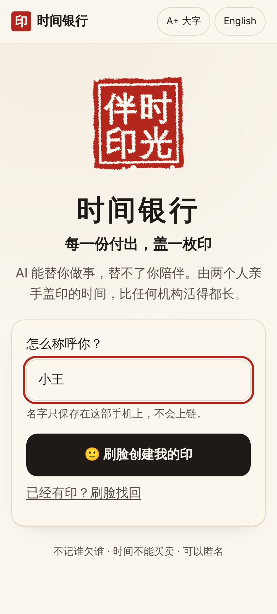
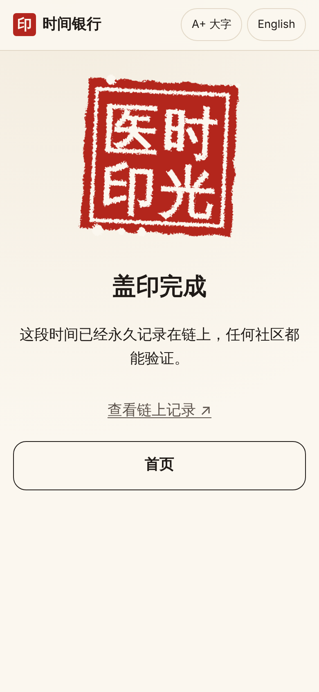
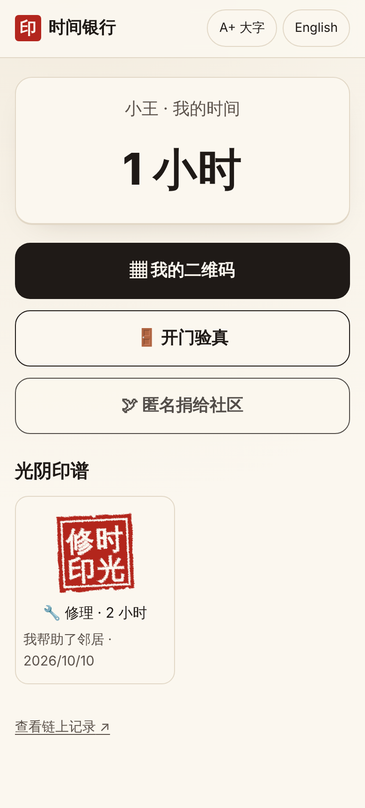
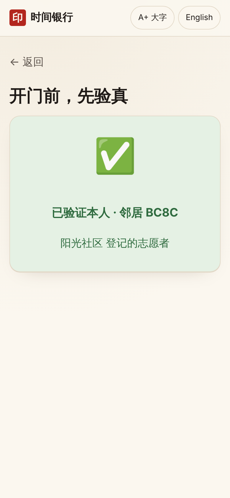

# 时间银行 TimeBank

**每一份付出，盖一枚印。Every hour of help, sealed by two people.**

AI can do things for you. It can't be there for you. TimeBank records time that neighbours give each other. Every hour is sealed in person by **two passkeys** (Face ID / fingerprint) and verified on **Monad** with its native P256 precompile, so the record outlives any operator.

Monad Metropolis 2026 · Track: Trust, Identity & AI Infrastructure

| Welcome | Seal landed | Seal album | Door check |
|---|---|---|---|
|  |  |  |  |

## The problem
- Time banks (volunteers bank hours of care and spend them later) are a recognised social model, with pilots run by the Chinese government, Timebanking UK and hOurworld (about 30k members in 22 countries).
- **Most of them die young.** A survey by the EU project TRANSIT, as cited in a Taiwanese thesis, found about 70% of time banks close within three years. Manual record-keeping and coordinator cost are among the main reasons. When a bank closes, people's hours go with it.
- **Hours don't travel.** Regional platforms don't recognise each other's hours. A Chinese report on Nanjing's time bank, 2023, names this the "通存通兑" problem.
- **Impostors at the door.** People posing as social workers and volunteers target older people living alone. There are reported cases in Korea, the UK, the US and the Philippines.

## What TimeBank does
1. **Face ID sign-up.** A passkey is your identity. There is no wallet, no seed phrase and no password.
2. **Two-person seal.** The person who was helped says "thank you" and signs. The helper scans the QR code and signs too. The contract verifies both WebAuthn signatures on-chain, credits the hours, and mints a generative seal.
3. **Give time to family.** A daughter in Shanghai gives her hours to her mother in another city, and a local volunteer takes her mother to the clinic. *"I can't be with you, but someone will be, for me."*
4. **Anonymous donation** to a community pool, which the community grants to people in need.
5. **Door check.** Before opening the door, the host shows a QR code. The visitor signs with their passkey, and within about a second the host's screen shows "verified, volunteer of Sunrise Community".
6. **Seal album.** Each seal is generated from its on-chain seed. It renders as a carved square seal in Chinese and a wax seal in English.

### Ethics, by design
- **Family members are never measured against each other.** Hours are earned with neighbours and strangers. Family only *receive* gifts.
- **Thanks, not debt.** The person who was helped starts the record. There are no "who owes whom" views and no leaderboards.
- **Time can be given, never sold.** There is no token, no market and no investment.
- **Privacy.** On-chain data is only pseudonymous ids, minutes and a category code. Names stay on the phone. No health data and no free text go on-chain.

## Why Monad
- **P256 precompile at `0x0100`.** Phone passkeys sign with P-256. Monad verifies those signatures natively, so every seal checks two real Face ID signatures on-chain cheaply. Without the precompile this would cost hundreds of thousands of gas in pure Solidity.
- **Sub-second finality.** Sealing and door checks happen face to face. A result in about a second feels like a stamp landing. Twelve-second blocks would not.
- **Throughput and fees.** Each act of help is a small write, which adds up to many writes at city scale. Community groups can't pay high fees.

## How it works
```
 receiver phone                    helper phone                     Monad
 ─────────────                     ────────────                     ─────
 pick help + minutes
 digest = sealDigest(...)  (eth_call)
 Face ID → WebAuthn assertion
 show QR ───────────────────────▶  scan, review
                                   Face ID → assertion
                                   POST /api/relay ──────────────▶  TimeBank.seal()
                                                                    ├ verify 2 × WebAuthn via P256 precompile
                                                                    ├ credit hours, bump nonces
                                                                    └ emit Sealed(seed)
                                   seal lands (animation + sound) ◀─┘
```
- `contracts/contracts/WebAuthnP256.sol`: rebuilds clientDataJSON around the challenge, requires the user-verified flag, and calls the precompile.
- `contracts/contracts/TimeBank.sol`: members are keyed by passkey public key. It provides `seal`, `gift`, `donate`, `grantFromPool`, `certify`, `verifyPresence` and `checkIn`. Nonces prevent replay.
- `web/`: the React app. It talks to WebAuthn directly with no wallet SDK. It recovers which member signed from the signature itself, so credential ids are never stored.
- `web/api/relay.ts`: pays gas so users never need a wallet. It holds no power, because the contract rejects anything without valid passkey signatures.

## Run it
### Contracts
```bash
cd contracts && npm install
npx hardhat test                       # 19 tests, real P-256 WebAuthn signatures
```
### Local end-to-end test (virtual passkeys)
```bash
cd contracts && npx hardhat node                                  # terminal 1
cd contracts && npx hardhat run scripts/deploy.js --network localhost
cd web && cp .env.example .env.local   # fill in the local address, RPC http://127.0.0.1:8545, chain 31337, a hardhat key as relayer
npm install && npm run dev                                        # terminal 2
node e2e/flow.mjs http://localhost:5173/ ../assets/screenshots    # 4 people: seal → gift → redeem → door check
```
### Deploy to Monad testnet
```bash
cd contracts && DEPLOYER_PRIVATE_KEY=0x... npm run deploy
```
Then deploy `web/` to Vercel with the environment variables in `web/.env.example`.

## Honest limits
- We are not the first "blockchain + time bank". Government and consortium-chain pilots exist. Our difference is a public chain, user-held records, cross-community recognition, and two-person passkey seals.
- A chain fixes record-keeping and trust. It does not fix low participation, which needs community work.
- Older people may need family or community staff to help them set up a passkey.
- Passkeys can sync through Apple or Google accounts, so a compromised cloud account is a risk. Future work: community-approved device changes.

## Disclosures
- **Originality / build window.** All code in this repository was written from scratch during the hackathon, starting 2026-10-10. No pre-existing project code was used. Open-source dependencies come from npm: Hardhat, solc-js, viem, @noble/curves, React, Vite, qrcode.
- **AI tools.** This project was built with Claude Code (Anthropic) as the coding and strategy assistant. The human author directed the product, ethics and scenario decisions. See `docs/`.

## Project memory
`docs/rules.md` · `docs/strategy.md` · `docs/decisions.md` · `docs/open-questions.md` · `docs/submission.md` · `docs/design.md`

MIT License
