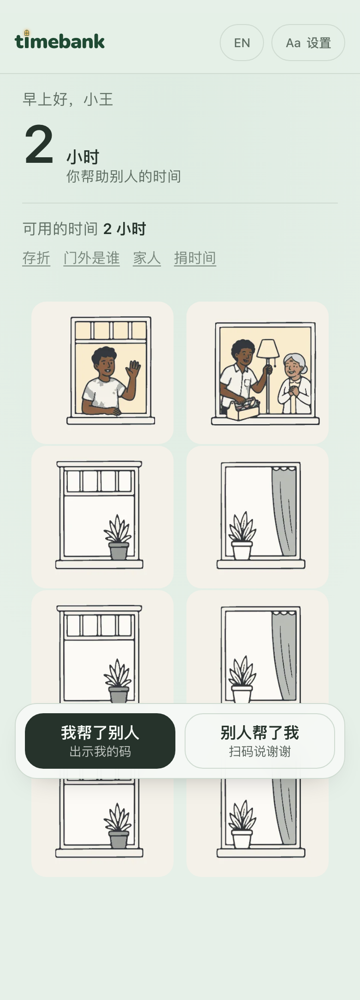
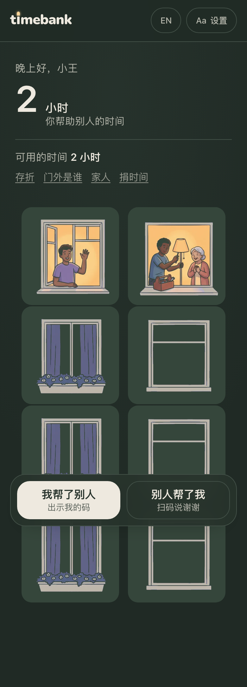
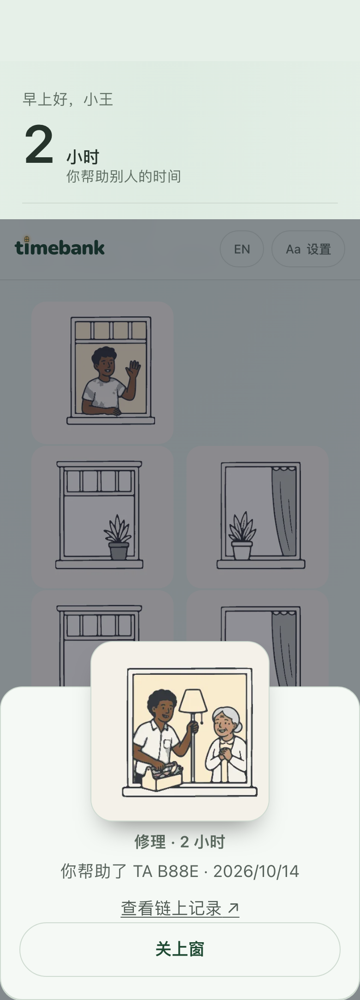
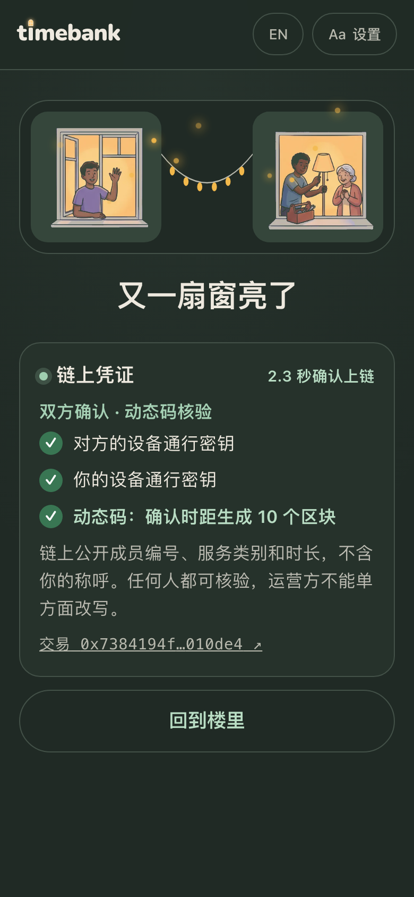
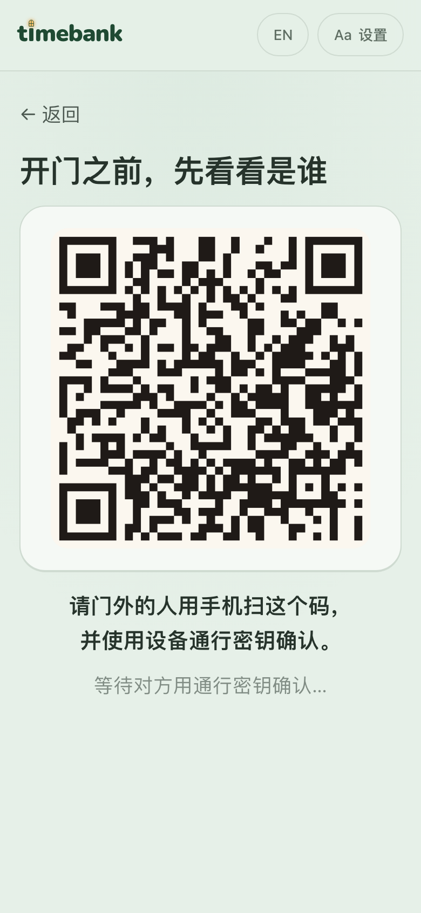

# timebank · 时间银行

**Every bit of care, seen. 每一份付出，都有人看见。**

**A two-party time record with an on-chain freshness check.** Both people sign the same record with a device passkey (which may use Face ID, fingerprint, or a device PIN). The recipient's screen shows a **heartbeat code** bound to Monad's block clock; the contract rejects codes more than 30 blocks old. This makes old screenshots expire, but does not prove physical proximity or prevent real-time relay or collusion.

**TimeBank is the first app built on it.** AI can do things for you; it can't be there for you. Neighbours bank the hours they give each other, and the record outlives any operator. The same check fits home-care visit verification, door checks against people posing as volunteers, and delivery sign-off: any app can read the public `Sealed`, `SealedInPerson` and `PresenceVerified` events.

**Live: https://monad-metropolis-2026.vercel.app/**

| Day | Night | A window opens | Seal: lights between two windows | Door check |
|---|---|---|---|---|
|  |  |  |  |  |

The app follows the viewer's local clock: soft green walls by day and a deep forest palette at night. The nine-window welcome scene animates into place; on the home facade, a window opens into a layered scene when tapped. Each completed seal lights the windows of the two people involved.

## Try it
> **Status: Monad testnet, demo data.** Every on-chain record so far was made by the author for testing. There are no real users or partner organisations yet.

Contract v4: [`0xb2dD5D6A8681aA7CC298fb29FF5b3fd2d4E5C176`](https://testnet.monadexplorer.com/address/0xb2dD5D6A8681aA7CC298fb29FF5b3fd2d4E5C176) ([source verified, full match](https://testnet.monadvision.com/contracts/full_match/10143/0xb2dD5D6A8681aA7CC298fb29FF5b3fd2d4E5C176/)) · example live-code seal: [`0x995362b3…0039`](https://testnet.monadexplorer.com/tx/0x995362b39e8d50c5f746036b9cbbb164a6aa85c821ab8409d9a0f3dae4190039)

Open the live link in **Safari (iPhone) or Chrome (Android / desktop)**. Chat apps' built-in browsers (WeChat, Alipay, Instagram…) don't support passkeys; the app detects them and shows how to switch. No wallet, no test tokens: a relayer pays gas.

A seal needs **two phones** (or a phone and a laptop with a passkey):
1. On both: enter a name and create a passkey to create your window.
2. **Helper:** tap "我帮了别人 / I helped someone". Your code appears.
3. **Person helped:** tap "别人帮了我 / Someone helped me" → "打开相机扫一扫 / Open camera to scan", scan the helper's code, pick what they helped with and for how long, then confirm with a passkey. A heartbeat code appears and changes as recent Monad blocks update.
4. **Helper:** tap "扫对方的码 / Scan their code", scan the heartbeat code, then confirm with a passkey. The seal lands in about 2 s with a link to the transaction, and both windows light up.
5. Open **存折 / Passbook** on the home screen to see the entry and its dynamic-code check. Try **门外是谁 / Door check** for the passkey-based account check.

One-device alternative: `cd contracts && TIMEBANK_ADDRESS=0xb2dD…C176 npx hardhat run scripts/smoke.js --network monadTestnet` runs the whole check (door check, seal, live-code seal, stale code rejected) against the live contract with simulated passkeys.

## The problem
- Time banks (volunteers bank hours of care and spend them later) are a recognised social model, with pilots run by the Chinese government, Timebanking UK and hOurworld (about 30k members in 22 countries).
- **Most of them die young.** A survey by the EU project TRANSIT, as cited in a Taiwanese thesis, found about 70% of time banks close within three years. Manual record-keeping and coordinator cost are among the main reasons. When a bank closes, people's hours go with it.
- **Hours don't travel.** Regional platforms don't recognise each other's hours. A Chinese report on Nanjing's time bank, 2023, names this the "通存通兑" problem.
- **Impostors at the door.** People posing as social workers and volunteers target older people living alone. There are reported cases in Korea, the UK, the US and the Philippines.

## What TimeBank does
1. **Passkey sign-up.** A passkey is used to control your account. There is no wallet, no seed phrase and no password.
2. **Two-person seal with a freshness check.** The person who was helped starts the record and signs. Their screen then shows a **heartbeat code** tied to a recent Monad block. The helper scans it and signs too. The contract verifies both WebAuthn signatures on-chain, checks that the scanned code is at most 30 blocks old, credits the hours, and mints a generative seal. Old screenshots expire; live relay and collusion remain possible.
3. **Give time to family.** A daughter in Shanghai gives her hours to her mother in another city, and a local volunteer takes her mother to the clinic. *"I can't be with you, but someone will be, for me."*
4. **Community pool donation.** Members can give hours to a community pool, which the community grants to people in need. The member ID is present in the transaction data, so this is not anonymous.
5. **Door check.** Before opening the door, the host shows a QR code. The visitor signs with their passkey, and within about a second the host's screen shows a matching account and its community volunteer registration, if present. This confirms account control, not the visitor's real-world identity; check the person at the door separately.
6. **Your building.** Your home screen is a building. Each act of help lights a window showing that scene, and you can tap a window to open it. Illustrations show neighbours of many ages and cultures. They were generated with Figma AI and art-directed by the author.

### Ethics, by design
- **Family members are never measured against each other.** Hours are earned with neighbours and strangers. Family only *receive* gifts.
- **Thanks, not debt.** The person who was helped starts the record. There are no "who owes whom" views and no leaderboards.
- **Time can be given, never sold.** There is no token, no market and no investment.
- **Privacy.** On-chain data is only pseudonymous ids, minutes and a category code. Names stay on the phone. No health data and no free text go on-chain. Member IDs and activity may still be linkable.

## Why Monad
**Measured on Monad testnet**, earlier contract `0xA15f3aBeABE823726070dF8Cea0e4E52d8bd234d` (v3): a two-passkey seal checks 2 WebAuthn signatures on-chain, uses **307,241 gas**, and was confirmed in **1.7 s** end to end from our test machine (619 ms on the first version, `0x5CffF394…49e`; latency includes our network path). A door check signed by the real person returns true and one signed by an impostor returns false. On the current contract `0xb2dD5D6A8681aA7CC298fb29FF5b3fd2d4E5C176` (v4, heartbeat seals), an ordinary seal used **330,050 gas** and confirmed in **1.7 s**, a heartbeat-enabled `sealInPerson` (declared limit **450,000 gas**, which Monad bills) confirmed in **1.9 s** with the heartbeat code **6 blocks** old, and a code more than 30 blocks old was rejected with `CodeExpired`. See `contracts/scripts/smoke.js`.

- **The block clock makes code freshness checkable.** Each heartbeat code is bound to a recent block number, and the contract accepts it only within `LIVE_WINDOW` = 30 blocks. Monad's fast blocks keep this window short enough for scanning and confirmation. This is a freshness check, not proof of physical proximity. Seals made this way are marked on-chain (`SealedInPerson`, `liveCodeBlock`, `inPersonMinutes`), so an integrating organisation can inspect the recorded fields.
- **P256 precompile at `0x0100`.** Device passkeys sign with P-256. Monad verifies those signatures natively, so each seal checks both WebAuthn signatures on-chain.
- **Fast confirmation.** Sealing and door checks are interactive. Our test transactions confirmed in about two seconds on the tested network path.
- **Throughput and fees.** Each act of help is a small write, which adds up to many writes at city scale. Community groups can't pay high fees.

## How it works
```
 receiver phone                    helper phone                     Monad
 ─────────────                     ────────────                     ─────
 pick help + minutes
 throwaway live key (memory only)
 digest = inPersonDigest(q, liveKey)  (eth_call)
 Passkey → WebAuthn assertion
 every second: sign(digest, latest
 block) with live key → heartbeat QR ─▶ scan, review
                                   Passkey → assertion
                                   code too old? scan the live screen once more
                                   POST /api/relay ──────────────▶  TimeBank.sealInPerson()
                                                                    ├ code block ≤ 30 blocks old
                                                                    ├ heartbeat signed by the passkey-approved live key
                                                                    ├ verify 2 × WebAuthn via P256 precompile
                                                                    ├ credit hours, bump nonces
                                                                    └ emit Sealed(seed), SealedInPerson(codeBlock)
                                   seal lands (animation + sound) ◀─┘
```
- `contracts/contracts/WebAuthnP256.sol`: rebuilds clientDataJSON around the challenge, requires the user-verified flag, and calls the precompile.
- `contracts/contracts/TimeBank.sol`: members are keyed by passkey public key. It provides `seal`, `gift`, `donate`, `grantFromPool`, `certify`, `verifyPresence` and `checkIn`. Nonces prevent replay.
- `web/`: the React app. It talks to WebAuthn directly with no wallet SDK. It recovers which member signed from the signature itself, so credential ids are never stored.
- `web/api/relay.ts`: pays gas so users never need a wallet. It holds no power, because the contract rejects anything without valid passkey signatures.

## Run it
### Contracts
```bash
cd contracts && npm install
npx hardhat test                       # 40 tests, real P-256 WebAuthn signatures
```
### Local end-to-end test (virtual passkeys)
```bash
cd contracts && npx hardhat node                                  # terminal 1
cd contracts && npx hardhat run scripts/deploy.js --network localhost
cd web && cp .env.example .env.local   # fill in the local address, RPC http://127.0.0.1:8545, chain 31337, a hardhat key as relayer
npm install && npm run dev                                        # terminal 2
node e2e/flow.mjs http://localhost:5173/ ../assets/screenshots    # 4 people: seal → forwarded photo refused → gift → redeem → door check
```
### Deploy to Monad testnet
```bash
cd contracts && DEPLOYER_PRIVATE_KEY=0x... npm run deploy
```
Then deploy `web/` to Vercel with the environment variables in `web/.env.example`.

## Honest limits
- No real users, interviews or partner organisations yet; all on-chain data is test data.
- We are not the first "blockchain + time bank". Government and consortium-chain pilots exist. Our difference is a public chain, user-held records, cross-community recognition, and two-person passkey seals. Cross-community recognition is a planned future capability that will require participating organisations and integrations; it is not live in the current version yet.
- A chain fixes record-keeping and trust. It does not fix low participation, which needs community work.
- Older people may need family or community staff to help them set up a passkey.
- **What the heartbeat code does not stop.** It limits replay of an old screenshot by rejecting stale codes. It does not stop a recently captured code from being relayed within the valid window, a live video call, or two people who agree to cheat. Two signatures reduce one-sided fraud; public records can support audits, but cannot make collusion impossible.
- Passkeys can sync through Apple or Google accounts, so a compromised cloud account is a risk. Future work: community-approved device changes.

## Credits
- The window illustrations were generated by the author with Figma AI and art-directed by hand.


MIT License
